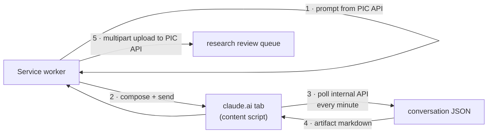

# APIfying Deep Research

[← Back to overview](README.md)

Before the extension, "running a research" meant this, by hand, for every article: click **Generate Prompt** in the admin panel and download the prompt file; open claude.ai; make sure the composer is in Chat mode; make sure the model is Sonnet on medium effort; open the "+" menu and enable Research; paste the prompt; send; wait a few seconds for a modal titled *"Enable connectors for Claude to use in research"* and disable everything in it; wait 15–40 minutes; open the finished report; find the download menu behind a caret on the Copy button; download as Markdown; go back to the admin panel; click **Upload Research**; find the file the browser just saved; upload. Twelve-plus interactions, two context switches, and a half-hour wait in the middle you had to remember to come back from.

The extension's job is to be that loop. Its design rests on one rule: **use an API everywhere one exists, and drive the DOM only where none does.** Everything on the Panama In Context side (listing suggestions, generating prompts, uploading results) was already an endpoint, because the admin panel is itself just an API client. The only place with no API was deep research. So the DOM automation is quarantined to one content script per origin, and everything else is plain `fetch`. When a second UI-only tool joined the project, [Grammarly's editor](04-driving-grammarly.md), it got its own driver under the same rule rather than leaking DOM code into the orchestrator.

## Recon before code

I didn't write the claude.ai driver from memory or guesswork. The first artifact of this project was a **recon document**, produced by driving a real logged-in claude.ai session and inventorying every element the automation would touch: the composer input (a ProseMirror `contenteditable` with a stable `data-testid`), the model selector (whose `aria-label` conveniently mirrors the current selection, so the driver can *verify* state without opening any menu), the effort options, the Research toggle in the "+" menu, the send button. The connectors modal can't be inspected without actually spending a research run, so its HTML was captured once from a live occurrence and mined for selectors the same way.

The selectors live in a registry file per site, each entry carrying a CSS selector, an optional text matcher, and a human-readable description that appears in every failure message. Two conventions keep it honest: prefer `data-testid` and `aria-label` hooks with visible-text matching as the fallback, and **never** use claude.ai's element ids, which are runtime-generated and change on every render. When claude.ai's UI drifts (it will), the fix is a one-file edit guided by a log line that says exactly which described element went missing.

That prediction got tested in September. Every research run started failing at the compose step with `Element not found: Research toggle in the "+" menu`. claude.ai had begun rendering its menu icons as icon-font glyphs, characters from Unicode's Private Use Area that sit *inside* the element's text, so a matcher anchored on `^research$` was now looking at "Research" plus an invisible glyph or two. The fix was one helper that strips those characters before any text match, which repaired every text-matched selector at once, plus a newly available `data-testid` for the toggle. The same week, the connectors modal's Confirm button lost the keyboard-shortcut attribute its selector relied on, and the fix was one registry entry matching the button by its label instead. Both failures named the missing element in the first line of the log; neither needed a debugger.

## The discovery that changed the design

The original plan for getting the finished report *out* was grim: automate the artifact drawer, the Copy-button caret, the "Download as Markdown" item, then watch the Downloads folder for a `compass_artifact_*.md` file, which an extension can't even read back without extra permissions and a file-picker dance.

Then recon found something better. From inside a claude.ai tab, the page's own **internal conversation API** is one same-origin `fetch` away (session cookies ride along automatically), and the response for a completed research contains the artifact's **entire markdown** as a field in the tool-call JSON (verified against a real report: all 48,730 characters of it). That one observation deleted a third of the planned automation:

Completion detection uses the same JSON, and it hid one more lesson. Deep research is **asynchronous under the hood**: the assistant launches a research *task* whose tool result comes back immediately carrying nothing but a task id, the turn then formally ends, `stop_reason` and all, while the research is still running, and the finished artifact is appended to that same message minutes later. So the turn ending means nothing. The run is done when an artifact with content exists, full stop; it is still running as long as a research task was launched, no matter how long ago the turn "ended"; and it has failed only when the turn ended without ever launching a research task (an inline answer, a refusal), which is a real, fast failure. The first version of the check trusted `stop_reason` and gave "ended without an artifact" a ten-minute grace period; three healthy runs whose research simply outlived that budget were declared dead with perfectly good reports minutes from landing. Now the only clock on a launched research is the run's own wall-clock timeout. The DOM's "Research complete · N sources" panel survives only as a fallback signal. The upload side needs no filesystem either: the markdown is wrapped in an in-memory `File` and posted as multipart, exactly as if a human had picked it from disk.

## Driving the composer anyway

Input still has to go through the UI, and framework-rendered editors don't accept naive DOM writes: setting `textContent` on the ProseMirror node leaves React convinced the composer is empty. The driver uses `document.execCommand('insertText')` instead, which runs through the browser's real input pipeline and updates the editor state properly. The proof is behavioral, because the **send button only exists when the editor state has content**, so its appearance doubles as the assertion that the insert worked.

Two timing lessons from live testing shaped this step. The content script (and its readiness ping) load long before React has painted the composer, so on a cold tab the driver's first lookups were racing the page; every compose now gates on the composer element appearing, with a full minute of patience. And the Chat/Cowork mode toggle turned out to be optional furniture: some sessions simply don't render it, and failing a run over a missing cosmetic toggle was the wrong trade. Verify it if present, assume Chat if absent.

## The connectors modal is a safety gate

A few seconds after sending a research, claude.ai asks which connectors the researcher may use: Gmail, Calendar, Drive, whatever the account has attached. For this pipeline the correct answer is always **none**; the research should cite the historical record, not wander through my mailbox. The driver clicks "Disable all tools", then *verifies*: every connector switch in the modal must read unchecked, and stragglers get re-toggled individually (a detail from the captured HTML: the visible switches are `inert` decorations, so the clickable target is each row's button). Only then does it confirm.

One switch gets special treatment: **"Always allow these connectors" must never be enabled.** Ticking it would make the modal stop appearing, and the modal *is* the safety gate. The automation deliberately keeps the interruption it then handles, every single run.

## A borrowed session, never credentials

The extension authenticates to the Panama In Context API the same way I do: it doesn't. The admin panel uses passwordless magic-link login, and after login the SPA holds an opaque seven-day bearer token in `sessionStorage`. A tiny content script on the admin panel notices that token and hands it to the service worker, which verifies it against the backend's token endpoint and caches it with its expiry. Every API call is `Authorization: Bearer …` from there; when the token lapses, the popup just says *open the admin panel to sign in* and the capture repeats. The extension holds no password, no API key, and nothing worth stealing beyond a week-scoped token the backend can revoke.

The claude.ai side is even simpler: it's my own logged-in browser. The extension doesn't authenticate to claude.ai at all; it *is* me, in the most literal session sense. Grammarly works the same way.

## No companion server

An earlier internal tool I'd worked on paired its browser extension with a server that owned the task queue. Here that would be a moving part with no job: the Panama In Context database already knows which suggestions await research, which claims await verification and which articles await proofreading, and the admin API already exposes all three. The extension is a pure client of existing systems. Nothing new to deploy, no queue to reconcile, and the browser-side automation can be rewritten wholesale without touching anything server-side; the contract is just endpoints and strict document formats.

---

[Next: The Run State Machine →](02-run-state-machine.md) · [Back to overview](README.md)
