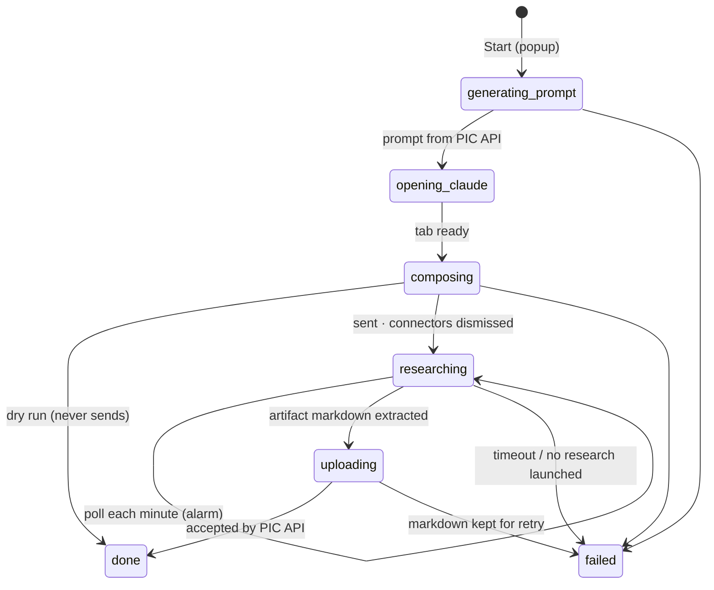

# The Run State Machine

[← Back to overview](README.md)

A research run is a 30-to-40-minute process hosted by a runtime that guarantees almost nothing: Manifest V3 service workers are killed after about 30 seconds of "idle", the popup dies the moment focus moves, and the claude.ai tab belongs to a human who might close it. The orchestrator's whole design follows from taking those constraints seriously: **one run at a time, every state transition persisted immediately, and every long wait re-entered through an alarm rather than awaited in memory.** This page describes the machine behind the two deep-research run types; grammar runs have [their own phases](04-driving-grammarly.md) on top of the same rules.

The popup renders whatever the persisted state says and nothing more. Close it, reopen it an hour later, and the run panel picks up exactly where the state machine actually is.

## The night the worker died

The very first live run taught the central lesson. The popup said *"Generating research prompt…"* for five minutes; the server logs showed the request had **never arrived**. What happened: prompt generation is a slow endpoint (it calls a model server-side), Chrome's idle reaper killed the service worker about 30 seconds in (a pending `fetch` does not count as activity), and the run's promise chain died silently with it. The state said `generating_prompt` forever, and nothing existed to notice the orphan. The process wasn't just interrupted; it was interrupted *undetectably*.

Three defenses came out of that failure, and they've held since:

1. **A keepalive while the worker owns a phase.** During the phases driven by an in-worker promise chain (prompting, composing, uploading), a 20-second timer calls a trivial extension API, which *does* reset the idle clock, so Chrome leaves the worker alone mid-fetch.
2. **A watchdog that assumes the worker already died.** Ownership of the promise chain is an in-memory flag, so a freshly restarted worker knows with certainty that any worker-bound phase it finds in storage is orphaned. A once-a-minute alarm (and a lazy check whenever the popup asks for state) reconciles: an orphaned **upload resumes** (the extracted markdown is persisted before upload precisely so a 40-minute research can never be lost to an upload hiccup), while an orphaned prompt or compose **fails fast** with a message saying whether a retry is safe. Minutes of silent hang became less than a minute to a named outcome.
3. **Start acknowledges immediately.** The popup's Start returns as soon as the state is persisted; the pipeline continues detached and reports through state, not through a response nobody may be around to receive.

The same lesson came back two months later in a shape I hadn't anticipated. A grammar run awaited a minutes-long command sent to the Grammarly tab, keepalive and all, and Chrome won't keep a worker alive for a single extension message left pending that long. The worker restarted mid-command, the watchdog did exactly what it was built to do with what it could see, and the result was an article stamped as proofread after two fixes. That story, and the rule it produced, is [on the Grammarly page](04-driving-grammarly.md).

## Polling a 40-minute job from a 30-second process

The `researching` phase needs no resident process at all. A `chrome.alarms` tick fires once a minute, wakes the worker, and the poll re-reads everything it needs from storage: which conversation, which tab, how long it's been. The completion check runs through the internal conversation API from *any* claude.ai tab, so if the original tab is gone, the poller quietly opens a background one and carries on. The human can close everything except Chrome itself.

The tolerances matter as much as the mechanism. A single failed poll never kills a run (tabs reload, networks blip); only five consecutive failures do. And the assistant turn "ending" is not a signal: deep research is asynchronous, so the turn formally ends while the research is still running and the artifact attaches to the same message minutes later. A launched research therefore stays `researching` until its artifact arrives, however many polls that takes; only a turn that ended without launching a research at all (an inline answer, a refusal) gets a ten-minute grace period before being declared failed. That leaves the hard timeout (90 minutes) as the sole backstop for a live research, and it's measured **per batch**, not per run, a detail that became load-bearing once fact-check runs started chaining multiple batches, any one of which is allowed to take the full window.

## Two more timing lessons

Both remaining live-test failures were races, not logic bugs. First: the content script announces readiness long before React paints the page, so the driver's element lookups on a cold, extension-crowded tab lost a race the recon session (on a warm profile) never exposed; the fix is gating every compose on the composer element's actual appearance. Second: declarative content-script injection occasionally just doesn't land on a fresh tab, so the readiness ping now self-heals. If it goes unanswered for a few seconds, the worker injects the scripts programmatically and keeps pinging, and the eventual timeout error carries the last underlying failure instead of a shrug. Both site drivers now share that ping-and-inject logic.

## Dry run and the narrated console

The single most valuable testing feature is also the simplest: **dry run, on by default.** It executes the entire pipeline up to and including inserting the prompt (model verified, Research enabled, connectors logic armed) and stops one click short of Send. Everything expensive and slow lives behind that one click, so the whole driving layer is testable for free, and a fresh install cannot fire a real research by accident. Grammar runs reuse the same switch with a different meaning: accept nothing, and prove the article survives the round trip through Grammarly unchanged.

Debugging follows the same philosophy as the selector registry: the automation narrates itself. Every command and compose step logs a `[pic]`-prefixed line to the tab's console, and every state transition logs in the worker's. When a live run fails, the last narrated line names the step; there's no reconstruction, just reading.

---

[← APIfying Deep Research](01-apifying-deep-research.md) · [Next: Run Types & the Fact-Check Drain →](03-run-types-and-fact-check-drain.md) · [Back to overview](README.md)
