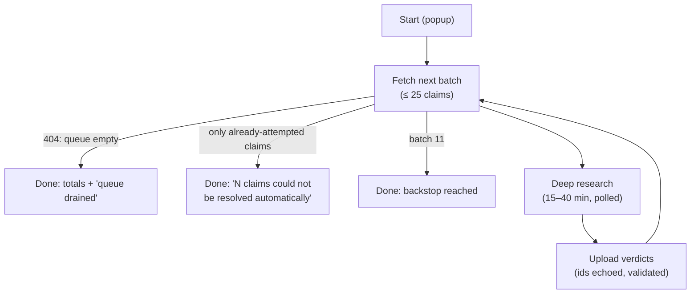

# Run Types & the Fact-Check Drain

[← Back to overview](README.md)

Once the first process worked end to end, the second one was cheap, by design. Everything hard about the pipeline (driving the composer, surviving worker death, polling, extraction) is identical whether the deep research is *writing* a research document or *verifying* a batch of claims. So the state machine is parameterized by a run type, and for these two a run type is really just two decisions: **which endpoint produces the prompt, and which endpoint receives the result.** Research runs call the research prompt/upload pair; fact-check runs call the fact-check pair. The 30 minutes in between are the same code path.

The third run type kept the contract's shape and nothing else. A grammar run still starts from one endpoint and ends at another, but the middle is a different site, a different driver, a per-article queue and a per-language policy, so it lives in its own module. That's the subject of [the next page](04-driving-grammarly.md). The endpoint pair turned out to be the reusable part; the middle is reusable only when the tool in the middle is the same.

## Research runs

A research run starts from an approved article suggestion in the popup. The prompt isn't assembled by the extension: the backend generates it, tailoring a research brief from the suggestion's topic, sub-topics and point of view. The upload side is equally backend-owned: the research document must clear a word-count floor, carry a references section (auto-compiled from inline citations when missing), and substantively cover the suggestion's sub-topics before it lands, as `PENDING`, because the extension automates the *transport*, never the editorial approval. The human gate the pipeline was built around is exactly where it always was; there's just no human courier anymore.

## The fact-check queue

The fact-checking layer decomposes suggestions, research documents, articles, and the educational materials and their research into atomic factual claims: database rows with verdicts. Its economics pivoted the whole system toward this extension. Verifying a research document through paid web-search calls cost about $11 a document and still punted a third of its claims, while deep research on the operator plan costs nothing. So the pipeline's default became *extract claims, match them against the verified-claims knowledge base, and queue everything unresolved for deep research*, which means a single fact-checked research document drops **around 100 claims, and up to about 200,** into a queue that this extension is the primary consumer of.

The loop's contract is deliberately rigid, because no human reads these documents in the middle. The prompt endpoint compiles at most 25 pending claims (deep research degrades beyond that), each numbered by its **database primary key**, never by list position, which is what makes the round trip unambiguous. The deep-research report must contain a `## Verdicts` section of one-line entries (claim id, verdict, note, citations), and the upload endpoint re-validates everything with the pipeline's signature conservatism: unknown verdict labels are skipped, definitive verdicts without citations are skipped, verdicts for claims that are no longer pending are skipped, and verdicts for claims *outside the batch that was asked about* are skipped. The extension echoes the batch's claim ids back with the upload precisely so that last check has teeth.

## Draining the queue automatically

One batch per click would have meant babysitting four to eight clicks and as many half-hour waits per research document. So a fact-check run **chains**: after each successful verdict upload, the run accumulates totals, closes the finished conversation's tab (only after its replacement exists, since closing first could take the whole window with it), and re-enters the pipeline for the next batch as if freshly started.

The interesting termination condition is the middle one. A claim whose verdict keeps failing validation (uncited, malformed) stays pending and would be re-batched forever; a naive drain would loop on it until the heat death of my token budget. The run therefore remembers every claim id it has already attempted, and stops the moment a new batch contains nothing else, reporting *how many* claims resisted automation, since those are precisely the ones that now deserve a human. A ten-batch backstop caps the blast radius of anything unforeseen, and the 90-minute timeout applies per batch, so a legitimate chain can run for hours while any *single* stuck batch still dies promptly. The backstop was sized when batches held 40 claims; at 25 it stops a run after 250 claims, more than any single document has queued so far, but a backlog of several documents can reach it, which costs nothing worse than pressing Start again, because the next run simply picks up the remaining queue.

Two pleasant emergent behaviors: the queue is global, so fact-checking a pile of documents and pressing Start once drains all of them, verdicts landing document by document; and because every definitive verdict feeds the knowledge base, *later documents' extract passes resolve more claims for free while the chain is still running*. The queue shrinks from both ends.

---

[← The Run State Machine](02-run-state-machine.md) · [Next: Driving Grammarly →](04-driving-grammarly.md) · [Back to overview](README.md)
