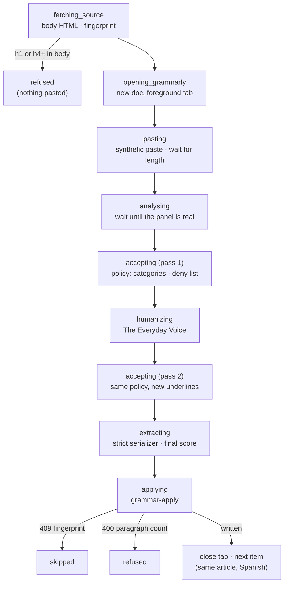
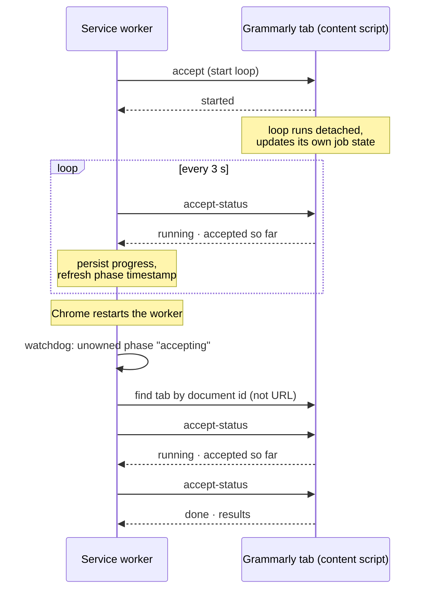

# Driving Grammarly

[← Back to overview](README.md)

Every Panama In Context article ships in English and Spanish, and every one of them gets a proofreading pass before it's considered finished. The pipeline once had an LLM grammar stage for this; it wasn't good enough and was switched off. What replaced it was me and Grammarly: open the article in the admin drawer, copy the rich text out while skipping the auto-generated "About this Article" and "Continue Reading" blocks, paste it into Grammarly, accept suggestions one at a time, copy it back, save, and do it all again for the Spanish version. Across a catalog of over a hundred articles, that loop was the next-largest block of human transport left in the system.

Grammar runs are the third run type, and the first that drives a site other than claude.ai. From the popup I choose a batch size from 1 to 10 and press Start. Each item is one article in one language. The extension builds the queue itself from the admin article list: approved articles missing a proofread stamp, lowest id first, English before Spanish. For each item the extension opens a fresh Grammarly document in a foreground tab, pastes the body, works through the suggestions, runs the Humanizer and a second accept pass, reads the result back, and sends it to the backend. When the backend accepts it the tab closes, and the next tab opens for the same article's Spanish version.

## The contract: the extension never sees markdown

Articles are stored as markdown with two auto-generated sections bolted on, an "About this Article" block before the body and a "Continue Reading" block after it, in both languages. The tempting design is to have the extension fetch the markdown, convert it to HTML, paste, and convert back. I didn't want that, for two reasons. A JavaScript port of the converter would drift from the Python one the admin drawer already relies on, so the same article could round-trip differently depending on which tool touched it last. And the auto-generated sections have no business being proofread, or even being held by a client that might write them back stale.

So the contract is **body HTML in, body HTML out**, and the backend owns everything around it:

- `grammar-source` splits the stored column into its three parts, converts only the body to HTML with the same functions the drawer uses, and returns it with a **fingerprint** (a hash of the whole stored column) and the body's block count.
- `grammar-apply` takes the body HTML back with that fingerprint. If the stored column changed in the meantime (a regeneration, a hand edit), the fingerprint no longer matches and the call is a 409; the item is skipped, untouched. It converts the HTML back to markdown and refuses with a 400 and a diff preview if the paragraph count changed, because proofreading never legitimately merges or splits paragraphs. Only then does it reassemble the column between the untouched sections, stamp the language as checked, and write one audit row per accepted suggestion.

The extension's job shrinks to the one thing only a browser can do. It never parses markdown, never sees the auto-generated sections, and can't corrupt them even when it's wrong about everything else.

## Reading the result back without a clipboard

Getting text *into* Grammarly turned out to be easy: a synthetic `paste` event carrying a `DataTransfer` with `text/html` goes through the editor's own paste handling, and the driver waits for the document's text length to stop growing. Getting it back *out* was not. A synthetic `copy` event is marked handled by the editor and writes nothing; reading the system clipboard needs a permission prompt, which is exactly the kind of human moment the extension exists to remove.

So the result is read from the DOM. A serializer walks the editor's top-level blocks using Grammarly's semantic class names for headings, paragraphs, list items, bold and italic runs, and links, and rebuilds clean HTML. It is deliberately **strict**: an unknown block or inline node, an underline, a strike-through or a nested list throws with the offending element's HTML in the error. A lossy read-back that gets written silently is the worst outcome this run type has, worse than a failed run, so the serializer prefers to fail.

Strictness has a blind spot, and it's worth being explicit about. Grammarly's editor has three heading levels. An `<h4>` pasted into it comes back as an `<h3>`, which is a perfectly valid node, so the serializer can't tell anything happened. The fix lives before the paste: a guard scans the source HTML for `h1` or `h4` and below and refuses the item before any Grammarly tab opens. No production article has an `h4` today; the guard is for the day someone adds one in the admin editor, which offers four levels.

Dry run doubles as the serializer's acceptance test. A dry run pastes, records every suggestion without accepting any, reads the document back and sends it to `grammar-apply` with `dry_run: true`. Nothing was accepted, so the backend must report that nothing changed. If it reports a change, the round trip itself is lossy, and the popup shows the backend's diff of exactly where.

## One item, end to end

Every phase is persisted like the deep-research phases are, every phase is worker-owned (keepalive on, watchdog armed), and the item's outcome is one of a small fixed set the popup can explain: applied, applied without a stamp, stamped with nothing to change, unchanged but below the score bar, refused, skipped, or on a dry run, a clean or drifting round trip. A refusal or a skip ends that item and the batch moves on; anything the driver doesn't understand fails the whole run with the step named.

## When is the suggestion list real?

The first live day, September 20, went to one question. Each fix produced a run that looked successful, accepted two or three suggestions, then applied and **stamped** the article as proofread. The stamped articles had to be put back in the queue by hand. Three layers of the same mistake were hiding behind that symptom.

- **The score is not a done signal.** On a fresh document Grammarly shows a numeric overall score while the suggestion panel is still a loading skeleton, for about fifteen seconds on a long article. The first version waited for "score is a number and the card count is stable", got there with zero cards, and moved on. There was a second trap in the same step: on a fresh document the panel is already open, just loading, so the driver clicking the panel's button to "open" it was in fact *closing* it. Analysis is now done only when the score is numeric **and** the category pills have rendered **and** the number of rendered cards matches the pill count **and** all of that is unchanged across three consecutive one-second polls.
- **The skeleton comes back after every Accept.** On a long article, Grammarly re-analyses after each accepted suggestion and shows the skeleton again, and the accept loop read its empty list as "nothing left in this category". Counts also cap at "99+", so "rendered cards equal the count" can never hold on a big document. The loop now refuses to read the list while the panel isn't loaded, waits up to 90 seconds for it to settle, and treats a capped count as "at least this many".
- **The skeleton can arrive between two lines of code.** Even with that check, the re-analysis starts asynchronously, so it could land between "the panel is loaded" and "read the cards". An empty list plus a missing pill evaluated as zero remaining. I reproduced it by running the content script's code directly in the page. Now a missing pill is never read as zero, a category counts as exhausted only after it's been seen exhausted twice with a stability wait in between, and the accept loop makes up to three passes over the categories, because accepting one suggestion can create a new one in a category that was already drained.

After those three fixes, running the content script directly in the page, the same 2,400-word article drained 23 suggestions with none stuck and all 38 paragraphs intact. The general lesson: in a UI that re-renders after every action, "empty" is a state you have to observe twice before believing.

## Never await a long command

Run from the extension, though, the old symptom survived all three fixes: a run applied two fixes, then opened the next article. The cause wasn't in the Grammarly driver at all, which is why testing the driver directly in the page couldn't see it.

The worker started the accept loop with a single `chrome.tabs.sendMessage` and awaited the answer, which on a long article takes many minutes. The keepalive from the [state-machine page](02-run-state-machine.md) was running, but Chrome doesn't keep a worker alive for one extension request left pending that long, and it restarted the worker mid-call. The fresh worker's watchdog found a worker-owned phase it didn't own and did what it was built to do: treated the item as orphaned and resumed it by reopening the saved document URL in a new tab. But the URL had changed. Grammarly renames a document's URL after its first heading, so `/d/Untitled-doc_<id>` had become `/d/Panama-s-Bastioned-Walls_<id>`, and the watchdog didn't recognize the tab that was still working. It opened a second one, closed the first one mid-loop, extracted the two or three fixes made so far, applied them, stamped the article, and moved on.

Two rules came out of it. The first is now written into the repo's instructions for anyone, human or agent, who works on it; the second lives in the code:

- **Never await a minutes-long content-script command over one message.** Long loops run detached inside the page, keeping their own progress object, and the worker starts them and then polls a status command every three seconds. Each poll persists the progress so far and refreshes the phase timestamp the stall watchdog reads, so a healthy loop never looks stuck, and the polling itself keeps the worker busy.
- **The URL is not the identity.** The document id after the last underscore in the path is stable. A restarted worker re-attaches to the tab whose document id matches, resumes from the stage it was in (first grammar pass, Humanizer, second pass, extract, apply), and carries forward everything already accepted. If the page itself reloaded and the loop is gone, the stage simply restarts, which is safe because both loops act only on what is still on the page.

## Operating it

A grammar run needs three things a research run doesn't. The admin session has to be live, as for every run. The Grammarly account has to be signed in; if Grammarly bounces the new document to its login page, the run fails immediately with "Grammarly is signed out" rather than waiting. And the Grammarly tab has to stay in front, because Grammarly doesn't analyse a document in a hidden tab, so a batch runs in its own window while I work in another. A batch of ten items is five articles in both languages, and the audit for each one is waiting in the popup when it's done, which is the subject of the next page.

*A Spanish article mid-run, in the run's own Grammarly window. The top card is a "Fix capitalization" suggestion on "oratorio", one of the card kinds the Spanish policy denies; the two "Improve your text" cards below it are Clarity rewrites.*

---

[← Run Types & the Fact-Check Drain](03-run-types-and-fact-check-drain.md) · [Next: What a Robot May Accept →](05-what-a-robot-may-accept.md) · [Back to overview](README.md)
