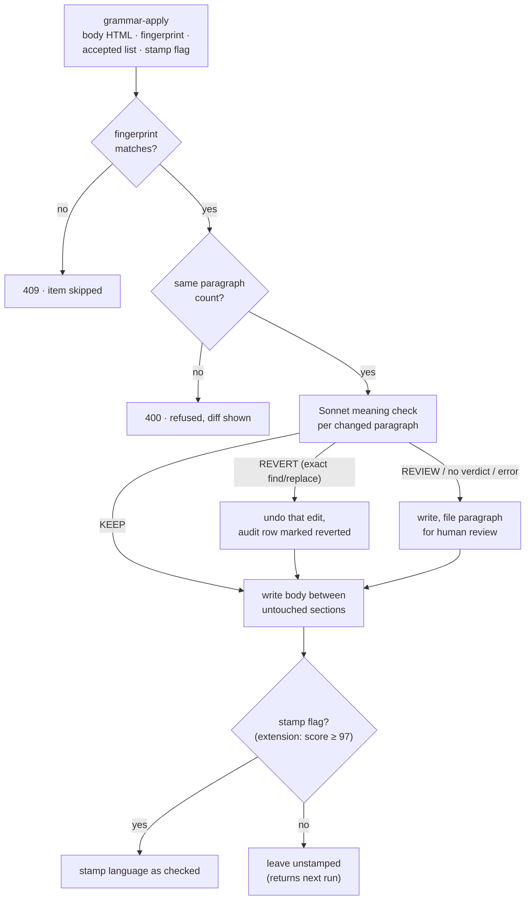

# What a Robot May Accept

[← Back to overview](README.md)

The previous page was about making Grammarly drivable. This one is about a harder question: once the driver works, which of Grammarly's suggestions should it be allowed to accept with nobody watching? The answer changed five times in a week, and the change that finally made a generous answer safe wasn't in the extension at all.

## The first live run

The first run that worked through a whole article, on September 20, proofread the English version of one article and accepted 25 suggestions. Five of the seven Grammar fixes were fine; two turned commas into stray hyphens. The other eighteen were Clarity rewrites, Grammarly's "Improve your text" cards, and they flattened the article's voice and in places changed what it said: "engineers would concentrate" became "engineers concentrated", a hedge turned into a claim. Earlier that day, while I was chasing the readiness bugs, a "Check wording" suggestion had turned "got assumptions" into "got fortifications", which happened to be the article's own punchline.

A one-off script on the backend reverted those twenty edits from the audit rows (token-based, tolerant of lost formatting, newest first so stacked fixes unwound in order) and cleared the stamp. The extension's default policy became **Grammar only** that same day. Clarity went back to being a human pass until something could judge it.

## Policy as data

In the meantime the policy itself became data rather than code: per language, which suggestion categories to accept, which kinds of card to deny even inside an accepted category, whether to run the Humanizer and with which voice, and the score an article must reach before it's stamped.

| When | Accepted | Denied | Also |
|---|---|---|---|
| Sep 20, first version | Grammar, Clarity | "Rewrite the sentence" | |
| Sep 20, same day | Grammar, Clarity | + "Check wording" | |
| Sep 20, evening | Grammar only | same | |
| Sep 21 | Grammar only, per language | Spanish also: "Fix capitalization", "Correct the mistake" | |
| Sep 22 | Grammar only | same | Humanizer on; stamp only at a score of 97+ |
| Sep 27 | Grammar, Clarity, Delivery | English: "Check wording". Spanish: "Check wording", "Rewrite the sentence", "Fix capitalization", "Correct the mistake" | same |

The Spanish deny list has a specific origin. Grammarly's Spanish proofreader doesn't know Panama: it wanted to capitalize or "correct" the words inside proper nouns like Ruta de la Plata and Panamá la Vieja. Denied cards are left in place and recorded in the audit, never dismissed, so nothing about a denial is invisible.

## The verifier that made "yes" safe

The last row accepts more than the first run did, and the reason is on the other side of the API. The evening of September 21, the backend's `grammar-apply` endpoint gained a **meaning check**: before writing, Sonnet reads every changed paragraph next to its original and returns one verdict per pair. The check landed within a day. Making it trustworthy took a week.

The verdicts are **KEEP**, **REVERT** (with an exact find and replace that's applied only if the find text occurs exactly once in the corrected body; otherwise it's downgraded to review) and **REVIEW**, which files the paragraph in a queue the admin dashboard shows as a "to review" pill. A missing verdict or a model error is treated as review, never as approval, which is the same skip-don't-guess conservatism as the fact-check upload. Paragraphs can be compared pair by pair only because the paragraph-count guard already guaranteed they line up.

The first version was too eager. In one day it reverted 27 of 186 edits, and by my hand count only about ten of those were real meaning changes; about ten were harmless tightening and the rest were judgment calls about voice. After a recalibration against a labeled set it caught 12 to 15 of 15 real meaning changes across runs and wrongly reverted at most 1 of 26 sound edits. With that in place, on September 27, the robot got Clarity and Delivery back. In production, across the 38 articles proofread in both languages, the check reverted 492 of 7,809 accepted suggestions (6.3%) and filed 30 paragraphs for review, all of which have since been resolved.

## The score gate

The last branch of that diagram came a day after the first meaning check, while the policy was still Grammar only. Many articles, especially in Spanish, finished their run with a low Grammarly score, and I wanted to know which ones needed my attention. So the extension compares the final score with the policy's bar of 97 and, below it, sends the result with `stamp: false`: the backend still writes the corrections but leaves the stamp unset, so the article returns on the next run and a stubborn one is easy to spot. An unreadable score stamps, so a Grammarly UI change can't strand the whole queue.

Once the calibrated check let the policy accept Clarity and Delivery alongside the Humanizer, scores came up across the board and the gate stopped firing. I kept it anyway. It costs nothing while scores are high, and if a future Grammarly change or a policy tweak drags them down, it's the alarm that goes off first.

## The Humanizer pass

The other half of my manual pass was Grammarly's Humanizer, which rewrites whole paragraphs in a chosen voice. I'd come to trust it more than Clarity's sentence-level edits because it rewrites a paragraph as a unit, and from the day it was automated its rewrites went through the meaning check. Automating it meant a second recon, because it's a much less cooperative UI than the proofreading panel:

- **There's no done signal.** After choosing a voice ("The Everyday Voice", in my case), decorations stream into the editor over several seconds, and the suggestion count appears on the voice card only when analysis finishes. There's no spinner and no busy attribute, so "still analysing" and "finished with nothing to suggest" look identical, and zero can only be inferred from a timeout.
- **A plain click doesn't open a suggestion.** A card opens only for a full pointer sequence (over, down, up, click, with real coordinates at the element's center). Accept and Dismiss inside the card respond to an ordinary click.
- **Suggestions are mapped to blocks by position.** Each one carries an id shared by its margin annotation and its card, and the annotation's vertical position lines up with the top of the paragraph it rewrites. That's how the driver knows which paragraph a card is about, reads its text before and after, and records the whole paragraph in the audit.

Two bugs from the first live Humanizer runs are worth keeping, because both are about visibility rather than logic. After the Humanizer, the second grammar pass failed with a missing category pill: the Grammarly panel's tab was still in the DOM underneath the Humanizer panel, so the driver's presence check believed the panel was already open and never switched back. Then a 57-paragraph Spanish article got only one or two rewrites even though the voice card counted five. The Humanizer draws its editor decorations **only while its own panel is the visible one**, and after the first grammar pass the proofreading panel was on top, but the Humanizer's voice button was still in the DOM, and **a hidden button still takes a click**. So the analysis ran and almost nothing was drawn. Both fixes replaced "is it in the DOM?" with "is it actually rendered?", and the walk now re-shows its panel if it slips behind and waits while the count still says there's work left.

Two smaller rules round it out. A card titled "Keep as is" proposes the paragraph unchanged. Accepting one waits for a change that never comes, so each burned a 40-second timeout, and on one Spanish article the fourth aborted the item; those cards are now dismissed. And a rewrite that would drop a link's text is dismissed rather than accepted, because the link is part of the article's sourcing. Bold and italic runs, on the other hand, don't survive a reworded sentence, and the meaning check compares stored markdown, so a lost `**` looked like a changed paragraph. Rather than fight that in the browser, the backend stopped generating inline emphasis in articles at all.

## The run explains itself

Debugging the first live day meant opening the service worker's console to find out what a run had done. Now the popup keeps a per-item audit: a headline like "#245 EN: applied, 12 accepted (4 rewrites), 1 reverted by Sonnet, 2 to review 88→97", the accepted suggestions with their before and after, every card the loops looked at grouped by what happened to it (accepted, denied, stuck, no change, link at risk), and on a refusal, the backend's diff. A Copy state button puts the whole persisted run state on the clipboard as JSON, ready to paste into a bug report or an agent session. The rules that decide anything (the heading guard, the policy defaults, the audit formatting) are pure functions with unit tests in CI, the project's first.

*The popup after a one-item Spanish run: 31 suggestions accepted, 27 of them rewrites, and 2 reverted by the meaning check. The article had been proofread before, so Grammarly scored it 99 at the start and at the end. Clicking the headline expands the item's full audit.*

## What's next

Nothing new is planned for the extension. The candidate I had in mind for the next run type, feature-image generation, turned out not to need a browser at all: the backend now calls the Gemini API directly. Two deliberate deferrals from the first version still stand: replicating the admin panel's pacing gate (don't start new research while review work is piled up), and per-subject scoping for fact-check runs, in case prioritizing one document ever matters more than draining the global queue. And one known gap is filed: the grammar queue should honor the backend's newer "ready for grammar" flags, so an article is never proofread before its fact-check corrections have landed.

## How a browser tab becomes an API

The broader takeaway I'd offer from this project still holds, and the second site tested it properly: an "unautomatable" manual process is usually three separable problems: a capability locked behind a UI, a transport loop, and a validation contract. Put the strictness in the contract (all three of this extension's document formats are machine-parsed with skip-don't-guess validation, and the strict serializer is the same idea pointed the other way), put the patience in the state machine, and the UI-locked capability only needs a thin, honest driver.

Grammarly added one more lesson I didn't have the first time. Automation should earn each new permission, and the way it earns one is a verifier, not confidence. The robot accepted Clarity rewrites on its first day and was wrong; it got them back a week later, when something independent could check its work. That's how a browser tab becomes an API you can actually let run.

---

[← Driving Grammarly](04-driving-grammarly.md) · [Back to overview](README.md)
