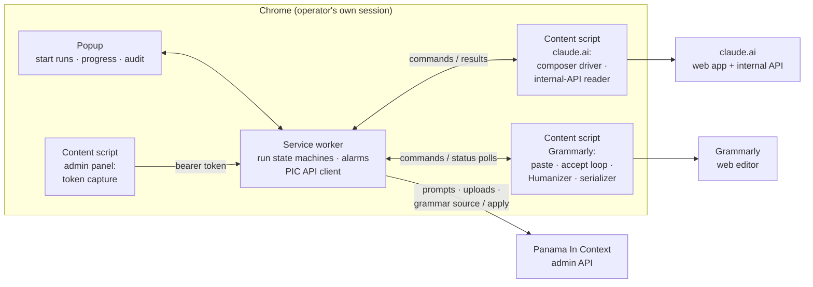

# PIC Companion

> A small Chrome extension that gives two UI-only tools an API, Claude's deep research and Grammarly's editor, and uses them to automate the slowest human loops in the Panama In Context content factory.

Panama In Context runs a research-first content pipeline: every blog article starts as a 5,000–8,000-word research document produced by Claude's deep research, every claim in it is fact-checked through the same deep-research capability, and every finished article is proofread in English and Spanish before it ships. Those three stages had the same awkward property: **the tool that does the work exists only in a web UI.** Deep research isn't in the Anthropic API, and Grammarly's API doesn't proofread anything. So for months the "integration" was me. I copied a prompt out of the admin panel, pasted it into claude.ai, clicked through a connectors modal, waited 15–40 minutes, downloaded a markdown file and uploaded it back. Then I did a similar dance through Grammarly for every article, once per language. I was the transport layer.

This extension replaces that. It's a Manifest V3 Chrome extension that drives claude.ai and Grammarly's web editor in my own logged-in browser session, talks to the Panama In Context admin API for everything that *does* have an API, and turns each loop into one click. It's a much smaller codebase than the main project, about 3,300 lines of vanilla JavaScript with no build step, but I think it's worth writing up, because the pattern generalizes: **any capability that only exists behind a UI can be given an API** if you're willing to treat the browser as the runtime. Building the second driver, for a much less cooperative UI, tested that claim harder than the first one did.

---

## What it does

One popup, three run types:

- **Research runs.** Pick an approved article suggestion; the extension asks the backend to generate the deep-research prompt, opens claude.ai, composes and sends the research (verifying model, effort and the Research toggle on the way), dismisses the connectors modal, polls until the run completes, extracts the report markdown and uploads it. From there the backend's validation (word count, references, sub-topic coverage) takes over. Some 30–40 minutes later a research document is sitting in the review queue, and no human touched anything after "Start".
- **Fact-check runs.** The fact-checking pipeline queues every claim it can't resolve cheaply as *needs deep research*, for the blog and for the educational materials alike. One click drains that queue: the extension fetches a batch of up to 25 claims as a verification prompt, runs it through deep research, uploads the verdicts document, and **chains the next batch automatically** until the queue is empty. One research document's worth of claims is typically four to eight sequential batches, two to four hours of unattended browser time.
- **Grammar runs.** Pick a batch size from 1 to 10, where each item is one article in one language. For each article, the extension fetches the English body from the backend as HTML, opens a Grammarly document, pastes it, accepts suggestions under a per-language policy, runs Grammarly's Humanizer, makes a second accept pass under the same policy, reads the result back out of the editor and sends it to the backend. Then it closes the tab and does the same for the Spanish version. The backend has the final word: it checks every changed paragraph for a change in meaning before anything is written. Between September 20 and 28, this proofread 38 articles in both languages.

All three share a **dry-run mode** (on by default). For the deep-research runs it performs every step up to, but never including, pressing Send. For grammar runs it pastes, records every suggestion without accepting any, and checks that the article survives the round trip through Grammarly unchanged. And all three survive me closing the popup or Chrome killing the extension's service worker mid-run, which it turns out Chrome does constantly.

---

## Why an extension, and not "the API"

Because there is no API for the parts that matter. Deep research is a claude.ai product feature: multi-query agentic search over tens of minutes, producing a cited report as an artifact. Nothing in the developer API does that today, and rebuilding an imitation out of API calls would cost real money per run, while deep research on my existing Max plan has **zero marginal cost**. The economics showed up starkly in the fact-checking work: verifying one research document through paid web-search calls cost about $11; through the deep-research loop it costs nothing but time. With a 44-document back-catalog to verify, that difference is the whole ballgame.

Grammarly is the same story with a different shape. Its API isn't offered to individuals, and what it does offer is about writing scores, AI and plagiarism detection, analytics and license management. Nothing in it returns grammar suggestions or fixes text in place. The proofreading I wanted lives only in the editor.

So the design question inverted: instead of "how do I call this capability from a server?", it became "how do I put a *server-shaped interface* on the browser where the capability already lives?" The answer is the classic browser-automation trio: content scripts to drive the pages, a service worker to orchestrate, and a strict document contract on both ends so no human judgment is needed in the middle.

---

## Feature highlights

- **Deep research, APIfied.** Compose, send, poll, extract, fully unattended. The extraction is the good part: instead of scraping the page or automating the Download button, the extension reads claude.ai's own internal conversation API from inside the tab and pulls the finished report's markdown straight out of the JSON. No Downloads folder, no file picker, no `downloads` permission.
- **Body HTML in, body HTML out.** The grammar run never sees markdown. The backend splits off the auto-generated sections and converts the body to HTML; on the way back it owns the conversion, a fingerprint check against concurrent edits and a paragraph-count guard. The extension's job shrinks to the one thing only a browser can do.
- **A strict read-back.** There's no clipboard trick for getting text out of Grammarly, so a serializer walks the editor's DOM and **throws on any node it doesn't recognize**. A lossy round trip fails loudly instead of being written silently.
- **A verifier before autonomy.** After its first live run the robot was allowed to accept grammar fixes and nothing else. The Humanizer came on once the backend had a Sonnet check that reverts any edit changing what a sentence claims, and Clarity rewrites came back only after that check was calibrated.
- **Zero credential handling.** The extension never sees a password or issues a login. It piggybacks on the admin panel's magic-link session: a content script picks the already-issued bearer token out of the admin SPA's `sessionStorage`, and every backend call rides on it until it expires. claude.ai and Grammarly are simply my own logged-in tabs.
- **No companion server.** The task queue is the Panama In Context database, reached through the same admin endpoints the dashboard uses. The extension is a pure client; there is nothing to deploy, monitor or secure server-side.
- **Survives Manifest V3.** Chrome kills idle extension service workers after about 30 seconds, a pending `fetch` doesn't count as activity, and a single extension message left pending for minutes doesn't keep a worker alive either. The first orphaned my very first live run; the second, two months later, orphaned a Grammarly run. The orchestrator is built around that reality: keepalives while the worker owns a phase, a watchdog that detects orphaned runs from a fresh worker, alarm-driven polling for the long waits, and minutes-long page work that runs detached in the tab while the worker polls it.

---

## The stack, broadly

| Layer | Technology |
|-------|-----------|
| **Extension** | Manifest V3, ES-module service worker, vanilla JavaScript, no bundler, no framework |
| **State** | `chrome.storage.local` (single persisted execution state), `chrome.alarms` for long waits |
| **Permissions** | `host_permissions` scoped to claude.ai, Grammarly (app and editor hosts), panamaincontext.com and a localhost dev backend only; `storage`, `alarms`, `tabs`, `scripting` |
| **Tooling** | ESLint (flat config) and a `node --test` suite on the pure helpers, both in the required CI check; load-unpacked for development |

---

## How the pieces fit

The service worker is the brain: it owns the run state machines, calls the Panama In Context API (host permissions exempt a worker from page CORS, so it's plain `fetch` with a bearer header), and messages a content script whenever something requires being *inside* a page. There are two of those site drivers now. The claude.ai one drives the composer and reads the internal conversation API with the session's own cookies. The Grammarly one pastes an article, works through the suggestion panel, runs the Humanizer and serializes the result. The popup is a thin window onto persisted state; you can close it any time. A third, tiny content script on the admin panel does exactly one job: notice the magic-link session token and hand it to the worker.

Everything long-lived is designed around the assumption that the service worker is *already dead*: state persists on every transition, long waits re-enter through alarms or status polls, and a watchdog reconciles whatever a worker restart interrupted.

---

## Table of contents

1. **[APIfying Deep Research](01-apifying-deep-research.md):** the manual loop, the recon that mapped claude.ai's composer, the internal-API discovery that eliminated the Downloads folder, the connectors-modal safety gate, and the borrowed-session auth model.
2. **[The Run State Machine](02-run-state-machine.md):** one run at a time, every transition persisted; the service-worker death that shaped the design; keepalives, watchdogs and orphan recovery; polling a 40-minute job from a process that lives for 30 seconds.
3. **[Run Types & the Fact-Check Drain](03-run-types-and-fact-check-drain.md):** the same skeleton parameterized for research generation and claim verification, and the auto-continuing batch chain that empties a 200-claim queue unattended.
4. **[Driving Grammarly](04-driving-grammarly.md):** the third run type, the body-HTML contract, a strict read-back with no clipboard, a suggestion panel that lies about being ready, and the worker restart that taught me never to await a long command.
5. **[What a Robot May Accept](05-what-a-robot-may-accept.md):** the first live run that flattened an article's voice, policy as data, the Sonnet meaning check that made it safe to accept more, the Humanizer pass, and what the whole project taught me.

---

*These pages describe the extension as of October 2026. It automates a real production pipeline; the [companion write-up for Panama In Context](https://feliu.dev/projects/panama-in-context) itself describes the systems on the other side of these API calls.*
